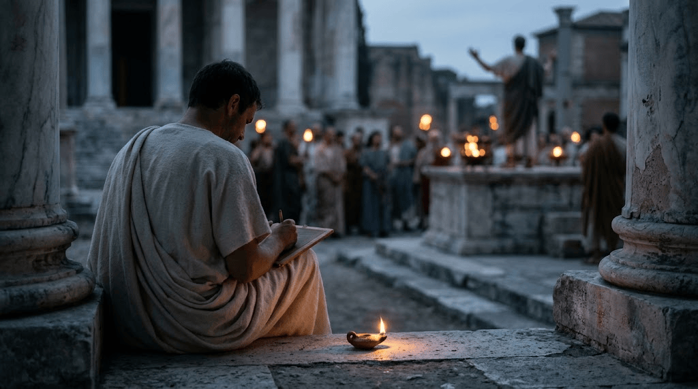

> "I have often wondered how it is that every man loves himself more than all the rest of men, but yet sets less value on his own opinion of himself than on the opinion of others."
> _Marcus Aurelius, Meditations 12.4_

Sometimes I forget that my own opinion matters more than other people's.

When that happens, I start changing my tone. I become more rhetorical, without realizing that a simple and direct approach is still the best one.

## Changing my tone

Sometimes it is politics. Sometimes I do not want the other person to feel weird about my tone or my intention.

Some of that is good. I work with other people, so I should think about how to communicate with them properly.

But I should not go as far as changing my intention or my originality just so other people feel comfortable.

## Whose opinion I listen to

What is worse is chasing praise from people I do not even respect.

I listen closely to people who walk the path of philosophy, who study it, practice it, and try to become the best version of themselves. I also listen to people whose judgment I trust.

Chasing praise from people outside that circle, people who are not trying to grow, is futile. It is not worth my time.

## A constant battle

I cannot deny that I want a better life. Part of me wants power, money, and even fame.

Marcus saw the same pull in himself:

> "Or does the desire of empty fame torment thee? see how soon everything is forgotten, and look at the chaos of infinite time on each side of the present, and the emptiness of applause, and the changeableness and want of judgement in those who pretend to give praise."
> _Meditations 4.3_

For me, it is a constant battle with myself. I keep reminding myself that these things are not worth it in this life.

What is worth it is becoming the best version of myself by practicing philosophy, being kind to others, and accomplishing what philosophy, and what God, want me to be.

## The question I ask

When I notice myself wanting someone's approval, I pause and ask: what is my intention here?

If the answer is that I am seeking their praise or their favor, and I am willing to change my thoughts, my fundamentals, or my philosophy to get it, then I know it is wrong.
